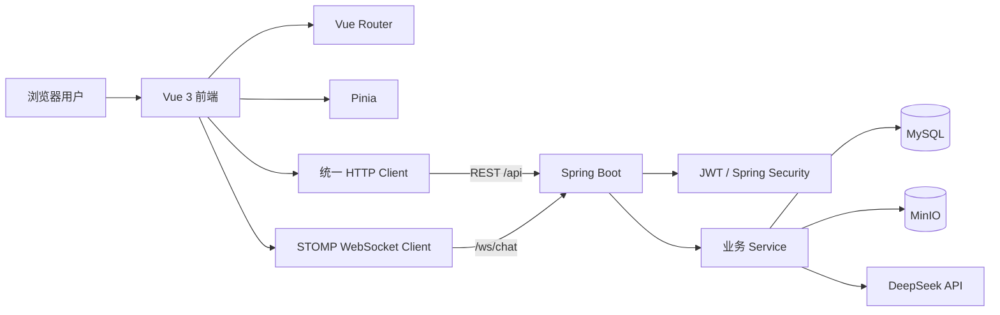
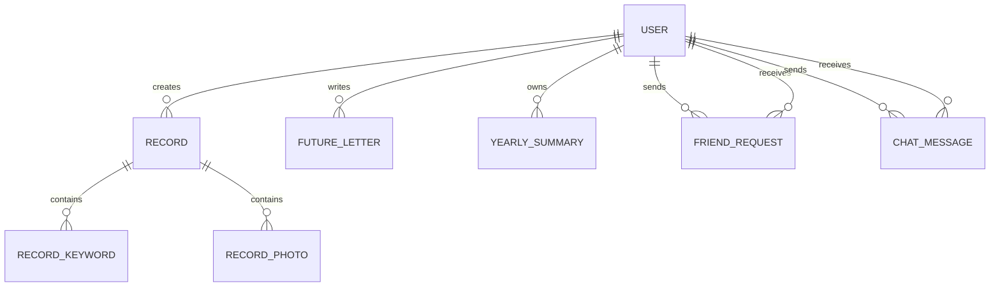

# Earth Online 答辩准备与项目架构指南

> 适用对象：目前对项目代码不熟悉，需要在较短时间内理解项目并准备前端暑期考核答辩的同学。  
> 考核依据：`E:/程序设计资料/大一下Java程序设计-汪华登/前端暑期考核.docx`。  
> 原则：只讲项目真实实现的内容，不把未完成的功能包装成已完成。

## 1. 答辩先记住这段项目介绍

Earth Online 是一个以“个人生活数字档案”为主题的全栈 Web 应用。用户注册登录后，可以记录生活事记、心情、标签和图片，通过时间线和年度图表回顾生活；可以给未来的自己写信，并在指定日期后开启；也可以添加好友并进行实时聊天。系统使用 DeepSeek 生成年度总结，并通过 RAG 年度回忆问答帮助用户从个人记录中查找和回顾具体经历。

项目不是简单的静态前端页面，完整链路包括：

- Vue 3 前端负责页面展示、交互和状态管理；
- Spring Boot 后端负责鉴权、业务规则和 REST API；
- MySQL 保存用户、记录、信件、好友、聊天和年度总结；
- MinIO 保存头像、记录图片和聊天图片；
- WebSocket/STOMP 负责实时聊天消息和好友事件；
- DeepSeek API 负责生成年度总结和基于检索记录回答年度回忆问题。

答辩时可以用一句话概括：

> 我做的是一个带有 AI 年度总结、RAG 回忆问答、未来信件和实时社交功能的个人生活档案系统，重点不仅是页面展示，还包括 JWT 鉴权、用户数据隔离、完整 CRUD、对象存储和实时通信。

## 2. 考核要求与项目完成情况

### 2.1 已满足的核心要求

| 考核要求 | Earth Online 对应实现 | 答辩证据 |
| --- | --- | --- |
| 使用 JavaScript 框架 | Vue 3 单文件组件 | `web/src/views`、`web/src/components` |
| 使用官方路由 | Vue Router，包含登录、首页、时间线、年度记录、未来信件、朋友和个人资料路由 | `web/src/router/index.js` |
| 使用全局状态管理 | Pinia 管理用户资料、记录、统计、关键词和未来信件 | `web/src/stores/profile.js` |
| 使用 UI 组件库 | Element Plus | `web/src/main.js`、各 Vue 页面 |
| 使用打包工具 | Vite，开发环境热更新，生产环境构建静态资源 | `web/vite.config.js`、`web/package.json` |
| 完整增删改查 | 生活事记和未来信件均具备创建、查询、修改、删除接口 | `records`、`futureletters` 模块 |
| 至少三个核心对象 | 用户、生活事记、未来信件、好友申请、聊天消息、年度总结 | 后端各 Entity |
| 后端与登录鉴权 | Spring Security + JWT + BCrypt | `SecurityConfig`、`JwtService`、`UserService` |
| 响应式布局 | 多个页面包含 1200px、900px、768px、640px 等断点；移动端使用底部导航 | Vue 页面样式、`App.vue`、`Sidebar.vue` |
| AI 应用能力 | DeepSeek 生成结构化年度总结；RAG 先检索相关记录，再生成带来源引用的回答 | `backend/.../ai`、`YearlyView.vue` |
| Git 代码管理 | 项目为 Git 仓库 | `.git`、提交记录 |
| 文件上传 | 图片类型和大小校验，文件存入 MinIO | `StorageService`、`UploadController` |
| 实时交互 | WebSocket/STOMP 实时聊天、已读回执、好友事件和断线重连 | `chatSocket.js`、`WebSocketConfig` |

### 2.2 部分满足或需要如实说明的要求

#### 权限管理

项目目前实现的是：

- 未登录用户不能进入业务页面；
- 登录用户只能访问自己的事记、未来信件和资料；
- 非好友不能正常进行好友聊天业务；
- 上传的图片对象名需要属于当前用户目录。

项目目前没有实现：

- 管理员、普通用户、访客三级角色；
- 管理员后台和内容审核；
- 页面元素基于角色的差异化展示。

答辩时不要说“已经完成 RBAC 角色权限系统”。正确表述是：

> 当前完成了认证和资源级权限隔离，保证用户只能操作自己的数据；角色权限是后续可扩展方向，可以在 User 中增加 role 字段，并在 Spring Security 中加入角色授权。

#### AI 能力

项目目前实现了两种贴合生活档案场景的 AI 能力：

- **AI 年度总结**：读取当前用户指定年份的全部记录，生成标题、总结、情绪概览、亮点、关键词解释和给未来的话；使用用户 ID 和年份缓存，并通过 `sourceHash` 判断总结是否过期。
- **RAG 年度回忆问答**：先按当前用户和年份隔离候选记录，再根据问题与标题、正文、关键词、事件类型和心情的匹配程度排序，选择最多 5 条记录交给 DeepSeek，最后返回答案和引用记录。

项目目前没有实现：

- SSE 流式输出；
- AI 多轮对话；
- Markdown AI 消息渲染；
- Embedding 和向量数据库检索。

正确表述是：

> 我没有加入泛用聊天机器人，而是围绕个人生活档案实现年度总结和 RAG 回忆问答。当前 RAG 使用轻量混合检索，已经包含检索、上下文增强、生成和来源引用；后续数据量增大时可以升级为 Embedding 和向量检索。

#### TypeScript

项目目前使用 JavaScript，没有使用 TypeScript。TypeScript 在考核文档中属于建议项而不是基础必备项。被问到时可以说：

> 当前优先完成了完整业务闭环。后续可以先把 API DTO、Pinia Store 和聊天消息类型迁移到 TypeScript，因为这些模块最需要类型约束。

## 3. 项目总体架构



### 3.1 前端分层

```text
web/src/
├─ views/          页面级组件
├─ components/     可复用组件
├─ router/         路由表与登录守卫
├─ stores/         Pinia 全局状态
├─ api/
│  ├─ httpClient.js 统一请求、Token、错误处理
│  ├─ chatSocket.js WebSocket/STOMP
│  └─ modules/       按业务拆分的 API
├─ styles/         全局样式和 SCSS 变量
└─ assets/         Logo、默认头像、背景图
```

前端调用关系：

```text
页面 View
  → Pinia Action 或 api/modules
  → httpClient
  → Spring Boot API
  → 更新响应式状态
  → Vue 自动更新 DOM
```

### 3.2 后端分层

```text
backend/src/main/java/com/earthonline/backend/
├─ config/         安全、密码、MinIO、WebSocket 配置
├─ auth/           JWT 生成解析和请求过滤器
├─ user/           注册、登录、个人资料
├─ records/        生活事记 CRUD
├─ futureletters/  未来信件 CRUD 和到期规则
├─ friends/        好友搜索、申请、接受、拒绝、删除
├─ chat/           REST 聊天、WebSocket、已读状态
├─ storage/        MinIO 图片上传和临时预览地址
├─ ai/             DeepSeek 年度总结、RAG 年度回忆问答
└─ common/         全局异常响应
```

典型后端调用关系：

```text
Controller 接收 HTTP 请求
  → Bean Validation 校验 DTO
  → Service 执行业务规则
  → Repository 操作 MySQL
  → Service 转换 Response DTO
  → Controller 返回 JSON
```

### 3.3 为什么需要 DTO

Entity 是数据库模型，DTO 是接口输入输出模型。两者分开有三个好处：

1. 不把密码哈希等数据库字段直接返回前端；
2. 可以使用 `@NotBlank`、`@Size`、`@Email` 等注解校验请求；
3. 数据库结构变化时，接口格式不一定跟着变化。

## 4. 核心对象与关系



需要注意两种实现方式：

- `FriendRequestEntity` 和 `ChatMessageEntity` 使用 JPA `@ManyToOne` 直接关联用户；
- `RecordEntity`、`FutureLetterEntity` 和 `YearlySummaryEntity` 使用 `userId` 字段进行用户隔离，没有声明 JPA 对象关系。

答辩时如果老师问“为什么每个查询都带用户 ID”，回答：

> 仅靠前端隐藏按钮不安全，后端必须根据 JWT 中的当前用户再次限定查询。比如事记使用 `findByIdAndUserId`，即使用户修改 URL 中的记录 ID，也不能读取或删除其他用户的数据。

## 5. 必须理解的六条核心业务链路

### 5.1 注册与登录

注册流程：

```text
LoginView 表单
→ POST /api/auth/register
→ RegisterRequest 参数校验
→ UserService 检查用户名和邮箱是否重复
→ BCrypt 加密密码
→ 保存 UserEntity
→ 设置 publicId 和系统默认头像
```

登录流程：

```text
POST /api/auth/login
→ 根据用户名查询用户
→ BCrypt 验证明文密码和密码哈希
→ JwtService 生成 Token
→ 前端保存 Token 到 localStorage
→ 后续请求自动添加 Authorization: Bearer <token>
```

需要掌握：

- 密码不能明文保存；
- BCrypt 每次加密结果可能不同，但仍能验证；
- JWT 是签名令牌，不是加密数据库；
- 前端路由守卫只改善体验，真正安全控制在后端；
- 后端使用无状态 Session 策略，每次请求都验证 Token。

### 5.2 生活事记 CRUD

这是最适合答辩演示的完整 CRUD：

- Create：发布记录；
- Read：首页最近记录、时间线、搜索和年度统计；
- Update：在时间线中编辑记录；
- Delete：删除自己的记录。

事记包含：标题、正文、记录日期、创建时间、事件类型、心情、关键词和图片对象名。

图片需要先上传到 MinIO，再把对象名随事记保存到 MySQL。数据库保存的不是图片二进制，而是类似下面的对象键：

```text
records/username/uuid.png
```

读取时后端生成短时效预签名 URL。这样 MinIO Bucket 不需要完全公开。

### 5.3 未来信件

核心业务规则：

- 信件可以是 `draft`、`sealed` 或 `opened`；
- 草稿不能直接开启；
- 当前时间早于 `openAt` 时不能开启；
- 到期后开启，状态更新为 `opened`；
- 查询和修改必须同时匹配当前用户 ID。

这部分适合回答“前端校验和后端校验有什么区别”：

> 前端禁用按钮只是交互提示，用户仍可能绕过页面直接调用 API，因此到期判断必须在后端再次执行。

### 5.4 好友与聊天

好友流程：

```text
使用 publicId 搜索用户
→ 发送好友申请
→ 对方接受或拒绝
→ 接受后双方成为好友
→ 才能查询和发送聊天消息
```

聊天同时使用 REST 和 WebSocket：

- REST 适合保存消息、查询历史、未读数量和标记已读；
- WebSocket 适合实时推送新消息、已读回执和好友事件；
- STOMP 提供目的地和订阅模型；
- JWT 在 WebSocket CONNECT 阶段验证；
- 前端每 5 秒自动尝试重连；
- `clientMessageId` 和数据库唯一约束用于降低重复发送风险。

### 5.5 AI 年度总结

```text
YearlyView 选择年份
→ 请求 /api/ai/yearly-summary
→ 后端读取当前用户当年记录
→ 生成 sourceHash
→ 查询缓存
→ 必要时调用 DeepSeek
→ 解析结构化结果
→ 保存 YearlySummaryEntity
→ 返回前端展示
```

为什么保存 `sourceHash`：

> 它代表生成总结时所使用的记录内容。如果后来新增或修改记录，重新计算的哈希不同，系统就能提示旧总结已经过期。

为什么 AI Key 只能放后端：

> 所有 `VITE_` 环境变量都会进入浏览器构建产物。如果把 DeepSeek Key 放在前端，任何访问者都能查看并盗用，因此必须由后端代为调用。

### 5.6 RAG 年度回忆问答

RAG 是 Retrieval-Augmented Generation，即“检索增强生成”。它不是模型，也不是必须安装的框架，而是一条先检索资料、再让大模型依据资料生成回答的应用链路。

```text
YearlyView 输入问题并选择年份
→ POST /api/ai/yearly-memory/query
→ Spring Security 从 JWT 获取当前用户
→ 按 userId + year 查询候选记录
→ YearlyMemoryService 计算记录相关度
→ 选择最多 5 条相关记录
→ 将问题和检索结果交给 DeepSeek
→ 返回 answer + sources
→ 前端展示答案和引用记录
→ 点击引用跳转时间线原记录
```

当前检索会比较问题与以下字段：

- 标题；
- 正文；
- 关键词；
- 事件类型；
- 心情。

为什么它属于 RAG：

> 系统不是直接把问题交给模型，也不是把数据库里所有数据全部发送出去，而是先从当前用户指定年份的记录中检索相关内容，再将检索结果作为上下文增强提示词，最终生成回答并返回来源引用。这包含了 Retrieval、Augmentation、Generation 三个步骤。

为什么第一版没有使用向量数据库：

> 当前单个用户每年的记录规模较小，使用字段匹配和相关度排序已经能完成业务闭环，部署成本也更低。等数据规模扩大、需要理解同义表达时，再加入 Embedding 和向量相似度检索。RAG 是方案，向量数据库只是可选的检索实现。

为什么一定返回引用记录：

> 引用让用户知道回答依据，也方便核对模型是否误解记录；答辩时它还是区分 RAG 与普通 AI 问答最直观的证据。

RAG 的安全边界：

- 用户 ID 由 JWT 决定，不接受前端传入的用户 ID；
- 检索必须同时限制当前用户和所选年份；
- 最多发送 5 条记录，减少隐私暴露和 Token 消耗；
- 系统提示词要求模型只依据记录回答，没有依据时明确说明；
- 未来信件和好友聊天不进入当前 RAG 数据源。

### 5.7 后端和 MinIO 故障降级

- MinIO 关闭时，后端捕获预览地址生成失败，普通文字资料仍可返回；
- 上传图片时 MinIO 不可用，会返回友好的上传失败提示；
- 后端关闭时，前端将 0 或 5xx 识别为服务不可用；
- Pinia 填充离线资料和空集合，页面不会因为 `userInfo === null` 白屏；
- 顶部显示统一提示并提供重新连接按钮。

这是一个可以在答辩中强调的工程亮点：外部依赖失败时，系统不会全部崩溃。

## 6. Vue 必须掌握的知识点

### 6.1 组合式 API

- `ref`：保存基本响应式值，例如加载状态、输入内容；
- `reactive`：保存表单对象；
- `computed`：根据已有状态派生数据，例如年度统计和筛选结果；
- `watch`：监听搜索词或年份变化，并触发副作用；
- `onMounted`：组件挂载后请求数据或连接 WebSocket；
- `onBeforeUnmount`：清除定时器、对象 URL 和 WebSocket。

要能解释：

> `computed` 适合有缓存的派生值，`watch` 适合请求接口、操作 DOM 等副作用，二者不能随意互换。

### 6.2 组件通信

- 父组件通过 Props 向子组件传递时间线等数据；
- 子组件通过事件或调用 Store 完成操作；
- 插槽用于 Element Plus 对话框、下拉菜单等结构；
- `v-model` 本质上是值与更新事件的语法糖。

### 6.3 Vue Router

路由使用懒加载：

```js
component: () => import('../views/YearlyView.vue')
```

只有访问页面时才加载对应 JavaScript，有助于降低首次加载内容。

全局前置守卫检查 Token：没有 Token 的用户访问业务页面时跳转登录页。需要明确：这不是后端权限校验的替代品。

### 6.4 Pinia

`profile.js` 保存跨页面共享的数据：

- 当前用户；
- 时间线；
- 事件统计；
- 心情趋势；
- 关键词；
- 未来信件；
- 后端在线状态。

这样 Header、首页、时间线、年度记录和个人资料使用同一份数据，避免每个组件维护互相冲突的副本。

### 6.5 Vite

Vite 的作用：

- 开发阶段使用原生 ES Module，启动和热更新快；
- 处理 Vue 单文件组件、SCSS 和静态资源；
- 通过环境变量配置 API 地址；
- 生产构建时压缩、拆分和生成带哈希的资源文件。

命令：

```powershell
npm.cmd run dev
npm.cmd run build
```

## 7. 后端必须掌握的知识点

### 7.1 Spring Boot 分层

- Controller：协议层，接收参数并返回响应；
- Service：业务层，进行权限、状态和业务规则判断；
- Repository：数据访问层，由 Spring Data JPA 实现查询；
- Entity：数据库映射；
- DTO：API 输入输出。

不要把所有业务写在 Controller 中，否则难以复用和测试。

### 7.2 REST 方法

| 方法 | 语义 | 项目示例 |
| --- | --- | --- |
| GET | 查询 | 查询记录、好友、历史消息 |
| POST | 创建或动作 | 注册、登录、发布记录、接受好友申请 |
| PATCH | 部分更新 | 修改资料、事记、未来信件 |
| DELETE | 删除 | 删除事记、信件、好友 |

### 7.3 常见状态码

- `400`：参数格式错误；
- `401`：没有登录或 Token 失效；
- `403`：已经识别用户，但没有权限；
- `404`：资源不存在，或出于安全考虑不暴露他人资源；
- `409`：用户名重复、信件未到期等业务冲突；
- `500/502`：服务器或上游服务故障。

### 7.4 JPA

需要理解：

- `@Entity`、`@Table`、`@Id`、`@GeneratedValue`；
- `@Column` 的非空、唯一、长度约束；
- `@ManyToOne` 和外键；
- `@ElementCollection` 保存关键词和图片对象名集合；
- Repository 方法名派生查询，例如 `findByIdAndUserId`；
- 唯一约束用于保证年度总结和聊天客户端消息不重复。

### 7.5 事务和并发

即使当前答辩不要求深入，也要知道潜在问题：

- 好友申请接受、消息保存等多步骤操作适合使用事务；
- 仅靠“先查询再保存”可能在并发下重复；
- 数据库唯一约束是最后一道一致性保护；
- 前端按钮加载状态只能减少重复点击，不能代替后端约束。

## 8. 建议的代码阅读顺序

不要从所有文件第一行开始读。按照一次请求的路径阅读。

### 第一轮：理解页面如何启动

1. `web/src/main.js`
2. `web/src/App.vue`
3. `web/src/router/index.js`
4. `web/src/components/Sidebar/Sidebar.vue`

目标：知道 Vue、Pinia、Router 和 Element Plus 如何挂载，页面如何切换。

### 第二轮：理解登录鉴权

1. `web/src/views/LoginView.vue`
2. `web/src/api/modules/auth.js`
3. `web/src/api/httpClient.js`
4. `backend/.../user/UserController.java`
5. `backend/.../user/UserService.java`
6. `backend/.../auth/JwtService.java`
7. `backend/.../auth/JwtAuthenticationFilter.java`
8. `backend/.../config/SecurityConfig.java`

目标：可以完整画出登录请求和后续 Token 验证过程。

### 第三轮：掌握一个完整 CRUD

1. `web/src/views/ProfileView.vue`
2. `web/src/components/Profile/Timeline.vue`
3. `web/src/stores/profile.js`
4. `web/src/api/modules/records.js`
5. `backend/.../records/RecordController.java`
6. `backend/.../records/RecordService.java`
7. `backend/.../records/RecordRepository.java`
8. `backend/.../records/RecordEntity.java`

目标：自己讲清楚一次新增、查询、修改和删除。

### 第四轮：理解亮点模块

- 未来信件：`futureletters`；
- 好友：`friends`；
- 实时聊天：`chat` 和 `chatSocket.js`；
- AI 总结：`ai` 和 `YearlyView.vue`；
- 图片：`storage` 和 `uploads.js`。

## 9. 七天答辩准备计划

### 第 1 天：跑通项目并画架构

- 启动 MySQL、MinIO、后端和前端；
- 完整操作一次注册、年度总结和 RAG 回忆问答；
- 手画“浏览器—前端—后端—MySQL/MinIO/DeepSeek”；
- 背熟第 1 节的项目介绍。

### 第 2 天：Vue 与前端

- 阅读 `main.js`、`App.vue`、Router、Pinia；
- 在页面中各找一个 `ref`、`reactive`、`computed`、`watch`、`onMounted`；
- 能解释组件、Props、事件、路由懒加载和响应式更新。

### 第 3 天：登录与安全

- 使用浏览器开发者工具观察登录请求；
- 找到 Token 保存位置；
- 跟踪 JWT Filter；
- 准备“前端守卫不等于后端鉴权”的回答。

### 第 4 天：CRUD 与数据库

- 选择生活事记作为主要 CRUD 演示；
- 从按钮一直跟踪到数据库 Entity；
- 画出核心对象关系；
- 理解 `findByIdAndUserId` 的安全意义。

### 第 5 天：亮点模块

- 实际测试未来信件未到期不能开启；
- 使用两个账号演示好友申请和实时聊天；
- 生成一次年度总结；
- 关闭 MinIO 和后端演示降级。

### 第 6 天：模拟追问

- 不看文档回答第 11 节问题；
- 每个回答控制在 30～60 秒；
- 遇到不会的问题先说明当前实现，再说合理扩展方案；
- 修正任何自己解释不清楚的代码。

### 第 7 天：完整彩排

- 计时进行一遍 8～10 分钟答辩；
- 提前准备两个测试账号和足够的年度记录，并准备能命中记录内容的 RAG 问题；
- 准备录屏或截图，防止 DeepSeek、网络或服务器临时故障；
- 检查密钥、密码和隐私内容不会出现在投屏中。

## 10. 推荐答辩演示流程（8～10 分钟）

### 0:00～1:00：项目背景

- 生活记录分散、缺少长期回顾；
- 因此设计个人生活档案；
- 亮点是未来信件、实时聊天、AI 年度总结和带来源引用的 RAG 回忆问答。

### 1:00～2:00：架构

- 展示架构图；
- 说明前后端分离；
- 说明 MySQL 保存结构化数据，MinIO 保存图片。

### 2:00～4:00：核心 CRUD

- 发布一条带心情和标签的记录；
- 在时间线查看；
- 修改；
- 删除或说明删除入口。

### 4:00～5:00：登录和数据隔离

- 展示登录；
- 说明 BCrypt 和 JWT；
- 指出事记查询按当前用户 ID 限定。

### 5:00～6:30：特色功能

- 未来信件；
- 好友与实时聊天；
- 图片上传。

### 6:30～7:30：AI

- 选择一个有记录的年份；
- 展示已有总结或生成总结；
- 在“问问这一年”输入一个能命中记录的问题；
- 展示回答依据并点击进入原记录；
- 解释年度总结缓存、`sourceHash` 和 RAG 检索链路。

### 7:30～8:30：工程质量

- 移动端适配；
- 后端或 MinIO 关闭后的降级；
- 自动化测试和 Git 管理。

### 最后总结

> 这个项目让我从只关注页面，转向理解完整的数据流、安全边界和系统可靠性。后续可以把轻量 RAG 升级为向量检索，并继续完善角色权限、SSE 流式输出和 Docker 化部署。

## 11. 高频追问与参考回答

### Q1：为什么选择 Vue？

Vue 的响应式系统和单文件组件适合中型交互页面；组合式 API 可以按业务组织状态；生态中 Vue Router、Pinia 和 Element Plus 能覆盖路由、全局状态和 UI 需求。

### Q2：为什么使用 Pinia，组件自己请求不行吗？

可以，但用户资料和时间线被多个页面使用。如果每个组件维护副本，会出现重复请求和状态不一致。Pinia 提供单一共享状态和统一 Action。

### Q3：为什么使用 Vite？

它负责 Vue 编译、模块解析、热更新、SCSS 和生产构建。开发时按需转换模块，生产时打包压缩并处理资源哈希。

### Q4：JWT 放在哪里？安全吗？

当前 Token 放在 localStorage，使用方便，但如果页面发生 XSS，Token 可能被读取。生产项目可以改为 Secure、HttpOnly、SameSite Cookie，并配合 CSRF 策略。当前项目通过输入限制、避免直接插入 HTML 和后端鉴权降低风险，但不能声称 localStorage 绝对安全。

### Q5：为什么关闭 MinIO 后文字还能显示？

文字数据在 MySQL。后端生成 MinIO 预览链接失败时返回空图片地址，而不是让整个资料接口失败，因此文字功能可以降级运行。

### Q6：为什么不用数据库保存图片？

数据库适合结构化查询，图片体积大。使用对象存储可以减少数据库压力，并通过对象键、访问权限和预签名 URL 管理文件。

### Q7：WebSocket 和 HTTP 有什么区别？

HTTP 通常是一问一答；WebSocket 建立长连接后，服务器可以主动推送。项目用 REST 保存和查询聊天记录，用 WebSocket 实时通知。

### Q8：如何保证用户不能删除别人的记录？

这里的用户 ID 指 `users.id`，它确实是 `UserEntity` 中使用 `@Id` 标注的数据库内部主键；不要和用于页面展示、好友搜索的 10 位 `publicId` 混淆。

删除链路是：JWT 验证后，Spring Security 中的 `Authentication` 保存当前用户名；`RecordController` 只把 `authentication.getName()` 和路径中的记录 ID 交给 Service；Service 再通过用户名查询当前用户的数据库主键 `users.id`，最后使用 `existsByIdAndUserId(recordId, userId)` 和 `deleteByIdAndUserId(recordId, userId)` 操作记录。即使攻击者修改 URL 中的记录 ID，因为该记录的 `user_id` 与当前登录用户的 `users.id` 不匹配，后端也不会删除。前端不需要、后端也不信任前端传入的用户 ID。

三个容易混淆的字段：

- `users.id`：数据库内部主键，供记录、信件、好友关系等表关联；
- `users.public_id`：对外展示和好友搜索使用的 10 位编号，不作为内部关联主键；
- `records.id`：某一条生活记录自己的数据库主键。

### Q9：AI 返回错误格式怎么办？

AI 调用在后端封装，应该校验和解析结构化响应；异常时返回统一错误，并且不覆盖已有总结。模型密钥也只保存在后端环境变量中。

### Q10：项目最大的不足是什么？

目前没有完整 RBAC、AI 不是流式输出、前端仍是 JavaScript、生产部署和监控仍可加强。回答不足后，要继续说明已经规划的改进顺序，不要只说“时间不够”。

### Q11：如果数据量变大怎么办？

列表接口需要真正分页；常用查询建立索引；年度统计可在后端预计算或缓存；图片走对象存储和 CDN；前端对大页面继续按路由拆包。

### Q12：为什么有 Controller、Service、Repository 三层？

分层可以隔离 HTTP、业务和数据库职责，便于测试、复用和维护。例如未来信件到期判断属于业务规则，应放在 Service，而不是散落在页面或 Controller。

### Q13：RAG 和普通调用 DeepSeek 有什么区别？

本项目原来的年度总结并不是“只把用户问题发给 DeepSeek”。它会按当前用户和年份读取当年的全部事记，把日期、标题、类型、心情、关键词和正文一起放入固定提示词，让 DeepSeek 生成一次结构化总结。因此它已经属于“有业务数据作为上下文的 AI 生成”，但它的目标是概括整年，没有用户自由提问，也没有根据问题从年度记录中挑选最相关内容。

新增的 RAG 年度回忆问答多了明确的检索环节：用户先提出问题，后端在当前用户、所选年份的安全边界内，根据问题对记录计算相关度，只选最多 5 条相关记录交给 DeepSeek，并把这些记录作为 `sources` 随答案返回。两者区别可以概括为：

| 对比项 | 原年度总结 | RAG 年度回忆问答 |
| --- | --- | --- |
| 用户输入 | 选择年份，使用系统固定总结任务 | 输入关于这一年的自由问题 |
| 上下文选择 | 读取该年份全部事记 | 根据问题检索并排序相关事记 |
| 输出 | 固定结构的年度总结 | 针对问题的回答 |
| 来源展示 | 只显示使用了多少条记录 | 返回并展示具体引用记录，可跳转原文 |
| 主要用途 | 获得整年全局概览 | 查找和回顾某类具体经历 |

答辩时不要把原功能说成“裸调 API”。更准确的说法是：

> 原年度总结是基于全年记录的固定任务生成；新增 RAG 是面向用户自由问题的“先检索、再生成”，还增加了来源引用和可追溯性。

### Q14：为什么不用 LangChain、LangGraph 或向量数据库？

RAG 是解决方案，LangChain 是组织模型、提示词和检索组件的框架，LangGraph 更适合有分支、持久状态和人工介入的复杂 Agent 工作流。当前项目是 Spring Boot 单体后端，问答链路简单、年度数据量较小，直接实现更容易维护和解释。后续需要语义检索时可以加入 Embedding 和向量数据库，但没有必要为了展示名词增加系统复杂度。

## 12. 答辩时不要说错的内容

- 不要说“JWT 对密码进行了加密”；密码由 BCrypt 哈希，JWT 用于身份声明和签名验证。
- 不要说“前端路由守卫保证接口安全”；接口安全由后端 Spring Security 和业务查询保证。
- 不要说“图片存在数据库”；数据库保存对象键，图片主体存在 MinIO。
- 不要说“实现了管理员权限”；当前没有角色模型。
- 不要说“实现了流式 AI 对话”；当前年度总结和 RAG 问答都是非流式响应。
- 不要说“RAG 使用了向量数据库或训练了 DeepSeek”；当前是轻量字段匹配与相关度排序，RAG 不会修改模型参数。
- 不要说“RAG 能查询所有用户数据”；它只检索 JWT 当前用户在所选年份的生活记录。
- 不要说“WebSocket 保证消息永久保存”；消息持久化由后端和 MySQL 保证，WebSocket负责实时传输。
- 不要说“关闭 MinIO 完全没有影响”；图片预览和上传会受影响，文字功能可以继续。
- 不要说“项目已完成生产部署”，除非 Docker、HTTPS、备份和服务器验收确实完成。

## 13. 实际练习清单

答辩前确保自己可以不看答案完成：

- [ ] 用 1 分钟介绍项目；
- [ ] 画出完整架构图；
- [ ] 解释一次登录请求；
- [ ] 解释一次事记新增请求；
- [ ] 指出 Token 在哪里保存和添加；
- [ ] 解释前端守卫与后端鉴权的区别；
- [ ] 说出至少三个核心对象及关系；
- [ ] 解释 MySQL 与 MinIO 的分工；
- [ ] 解释 REST 与 WebSocket 的分工；
- [ ] 解释年度总结缓存和 sourceHash；
- [ ] 解释 RAG 的检索、增强、生成和来源引用；
- [ ] 说清当前轻量检索与向量检索的区别；
- [ ] 演示从 RAG 引用跳转到时间线原记录；
- [ ] 演示移动端布局；
- [ ] 演示 MinIO/后端故障降级；
- [ ] 如实说出未完成项和改进方向；
- [ ] 准备断网时使用的截图或录屏。

## 14. 最有效的学习方法

不要尝试背下所有代码。对每个核心模块只回答五个问题：

1. 用户从哪个页面触发？
2. 前端调用哪个 API？
3. 后端哪个 Controller 接收？
4. Service 做了什么业务和权限判断？
5. 最后写入哪个 Entity/数据表，响应如何回到页面？

如果能独立回答登录、生活事记、未来信件、好友聊天和年度总结这五条链路，就已经掌握了项目的主体。

## 15. 建议准备的答辩材料

- 一页项目背景与目标；
- 一页总体架构图；
- 一页核心对象关系图；
- 一页主要功能截图；
- 一页登录鉴权流程；
- 一页 AI 年度总结与 RAG 回忆问答流程；
- 一页考核要求对照；
- 一页不足与后续计划；
- 2～3 分钟关键功能备用录屏。

这份 Markdown 可以直接作为答辩复习主文档，再据此压缩成 PPT。先理解链路，再记术语；先保证回答真实，再追求表达漂亮。
